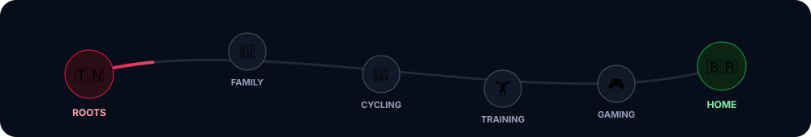

 

## About

I'm a **Senior Frontend Developer** and **Senior SDET / Test Automation Engineer**. I work across the full path from interface to release: I design and build user interfaces, then write the automated tests, quality gates, and CI checks that keep them stable.

My open-source work includes test automation for [**BigBlueButton**](https://github.com/bigbluebutton/bigbluebutton), the open-source virtual classroom platform. I have contributed browser tests for multi-user meetings, mobile and tablet layouts, connection recovery, and visual regressions.

<table>
<tr>
<td width="50%" valign="top">

#### 🎨 Frontend engineering
- React and TypeScript applications
- Reusable components and design systems
- Responsive, accessible interfaces
- Performance tuning and maintainable state

</td>
<td width="50%" valign="top">

#### 🧪 Test automation and SDET
- Test strategy and automation architecture
- Playwright, Cypress, and Puppeteer suites
- API, BDD, visual regression, and E2E tests
- CI pipelines, reporting, and flaky-test triage

</td>
</tr>
</table>

## How I work

I treat quality as part of frontend engineering. A feature is done when users can rely on it: the UI behaves well on real devices, critical journeys are covered by tests, and the CI pipeline catches regressions before release.

## Selected work

<table>
<tr>
<td width="50%" valign="top">

### [BigBlueButton](https://github.com/bigbluebutton/bigbluebutton)
**Open-source contributor · Test automation**

Browser automation for the BigBlueButton HTML5 client, including mobile and tablet tests, multi-user flows, reconnection scenarios, and visual regression checks.

`React` `Puppeteer` `Visual testing` `CI`

</td>
<td width="50%" valign="top">

### [bbb-puppeteer](https://github.com/daminebenq/bbb-puppeteer)
**E2E test suite**

Puppeteer scripts that exercise BigBlueButton meeting features against a structured test plan.

`JavaScript` `Puppeteer` `E2E` `Test plans`

</td>
</tr>
<tr>
<td width="50%" valign="top">

### [playwright-cucumber-api-test](https://github.com/daminebenq/playwright-cucumber-api-test)
**BDD API automation · [HTML report](https://daminebenq.github.io/playwright-cucumber-api-test/cucumber_report.html)**

A Playwright and Cucumber framework with positive and negative API scenarios, JSON schema validation, and published reports.

`Playwright` `Cucumber` `BDD` `JSON Schema`

</td>
<td width="50%" valign="top">

### [dummyjson-cypress-automation-ts](https://github.com/daminebenq/dummyjson-cypress-automation-ts)
**Typed API test suite**

28 Cypress tests in TypeScript covering CRUD, search, categories, and pagination, with tag filtering, parallel runs, and dashboard recording.

`Cypress` `TypeScript` `API testing` `CI`

</td>
</tr>
</table>

## Tech stack

**Frontend** 

**Testing and quality** 

**Delivery** 

## GitHub activity

Generated from the GitHub API by a small script in this repository. No third-party statistics service or visitor tracking.

## Beyond the keyboard

Tunisian, based in Rio Grande do Sul, Brazil. At home with Kovu, Dwala, Black, and Spritz. Outside work I ride, train, and play games.

## Get in touch

I'm open to senior frontend, SDET, and test automation roles, and to open-source collaboration. Reach me on [LinkedIn](https://linkedin.com/in/damine-bens) or by [email](mailto:damineone@gmail.com), or see more of my work at [damine.io](https://damine.io).
