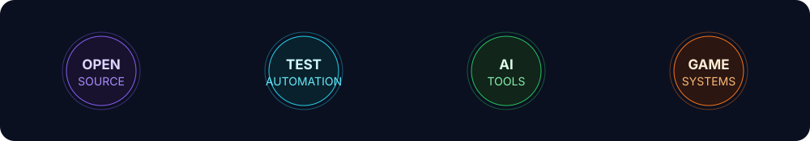

  

   

  
  
  
  

## Hello, I'm Mohamed

I build dependable software, automate quality checks, and contribute to open-source products used by real communities. My work spans **test automation**, **developer tooling**, **AI-assisted workflows**, and **real-time systems**. I am an active contributor to [BigBlueButton](https://github.com/bigbluebutton/bigbluebutton), the open-source virtual classroom platform.

- 🔭 Building practical tools that remove repetitive work and make complex systems easier to operate.
- 🧪 Turning quality into code with browser automation, CI pipelines, and repeatable tests.
- 🌍 Tunisian roots, based in Rio Grande do Sul, Brazil.
- 🤝 Open to open-source collaboration and ambitious engineering problems.

## What I work on

<table>
<tr>
<td width="50%" valign="top">

### [smart-terminal](https://github.com/daminebenq/smart-terminal)

An AI-powered CLI that translates natural language into shell commands, assesses risk, searches the web, and keeps a human approval step in the loop.

`Python` `CLI` `AI` `Safety`

</td>
<td width="50%" valign="top">

### [bbb-puppeteer](https://github.com/daminebenq/bbb-puppeteer)

Automated browser testing for BigBlueButton, built to make core meeting flows repeatable and easier to validate.

`JavaScript` `Puppeteer` `E2E Testing` `BigBlueButton`

</td>
</tr>
<tr>
<td width="50%" valign="top">

### [cs2-stats-web](https://github.com/daminebenq/cs2-stats-web)

A public statistics and leaderboard platform with live server status, player profiles, rankings, credits, and shareable scoreboards.

`PHP` `MySQL` `A2S` `Open Graph`

</td>
<td width="50%" valign="top">

### [cs2-arena-elo](https://github.com/daminebenq/cs2-arena-elo)

A persistent 1v1 arena ranking system for Counter-Strike 2, backed by CounterStrikeSharp and MySQL.

`C#` `.NET` `MySQL` `Game Servers`

</td>
</tr>
</table>

## Toolbox

## Live GitHub activity

This dashboard is generated from the GitHub API every day by a dependency-free script in this repository. No third-party statistics service tracks profile visitors.

## Beyond code

Life is shared with **Kovu, Dwala, Black, and Spritz**. Away from the keyboard, you will usually find me cycling, training, gaming, listening to music, or exploring southern Brazil.

## Let's build something useful

The best way to reach me is through [LinkedIn](https://linkedin.com/in/damine-bens) or [email](mailto:damineone@gmail.com). You can also explore my work at [damine.tn](https://damine.tn).

  
  

